# Nasa-English — Microgravity Combustion Analysis & Spacecraft Fire Safety Platform

[](LICENSE)

- **Live Web App (Zero Install, Run Directly in Browser):** https://faruk042.github.io/Nasa-English/
- **Standalone Windows Desktop App (`Nasa_4.exe` — Zero-Install Download):** https://github.com/Faruk042/Nasa-English/releases/latest

---

## Why We Built This Platform

When you light a candle or match on Earth, buoyancy quietly governs everything you see: hot combustion gases expand, become less dense than surrounding air, and rise (`Gr > 0`, `Ra > 0`). That upward draft continuously pulls fresh oxygen into the base of the flame, stretches the reaction sheet into a vertical teardrop, and heats soot particles until they glow bright yellow-orange.

In orbital freefall (`0G`), natural buoyancy disappears (`Gr -> 0`, `Ra -> 0`, `Ri -> 0`). Hot gases no longer rise, smoke does not collect at the ceiling, and oxygen reaches the reaction zone only through slow molecular diffusion or forced cabin ventilation. For crewed spacecraft engineering, that single shift creates three practical fire-safety hazards:

1. **Invisible Cool Flames (`550–750 K`):** During liquid-droplet combustion tests aboard the International Space Station (`FLEX` and `FLEX-2`), radiative heat loss (`χ_r`) often quenches the visible high-temperature flame without stopping oxidation altogether. Instead, the fuel transitions into negative-temperature-coefficient (`NTC`) low-temperature chemistry (`550–750 K`) — emitting almost no visible light while steadily releasing toxic carbon monoxide (`CO`) and formaldehyde into a closed cabin.
2. **Low-Velocity Ventilation Hazard (`3–8 cm/s`):** Turning cabin fans down rather than shutting them off completely can make a spacecraft fire worse. As `BASS` and `Saffire` flights demonstrated, gentle airflow around `3–8 cm/s` is too weak to blow a flame out yet fast enough to replenish oxygen faster than molecular diffusion, allowing solid polymers to keep burning below their normal `1G` minimum oxygen concentration (`MOC`).
3. **Lunar (`0.16G`), Martian (`0.38G`), and EVA Spacesuit (`4.3 psia, 100% O₂`) Atmospheres:** Exploration habitats and pressurized rovers reduce total cabin pressure while raising oxygen mole fraction (`10.2 psia, 32% O₂` or `8.2 psia, 34% O₂`) to shorten pre-breathe times before extravehicular activity (`EVA`). Partial gravity reintroduces weak buoyant flow alongside enriched oxygen, accelerating solid-surface `de Ris` flame spread relative to standard `14.7 psia, 21% O₂` station air.

**ALTAR-NASA (`Flame in Freefall v6.3`)** brings these regimes together in a single engineering workbench. It couples dimensionless transport equations, a 3D WebGL combustion chamber, a 5-compartment `Orion MCP` spacecraft fire-response model, verified NASA `Physical Sciences Informatics (PSI)` and `NTRS` records, computer-vision flame calibration, and an offline-capable analytical solver.

---

## Step-by-Step Visual Walkthrough

### 1. Mission Control Overview, ISS 0G Calibration, and 5-Phase Material Certification

Opening the application brings up the **Combustion Chamber** workspace. Directly beneath the top status bar, the `NASA-STD-6001B` **Mission Material Certification** strip evaluates the selected fuel or cabin polymer across five mission environments (`ISS 0G Cabin`, `Orion Deep-Space Transit`, `Lunar Habitat 0.16G`, `Mars Surface Cabin 0.38G`, and `EVA Spacesuit 4.3 psia`). In the subbar above, the solver continuously benchmarks its `0G` droplet burning rate against ISS `FLEX` flight telemetry (`R²` and `RMSE`).

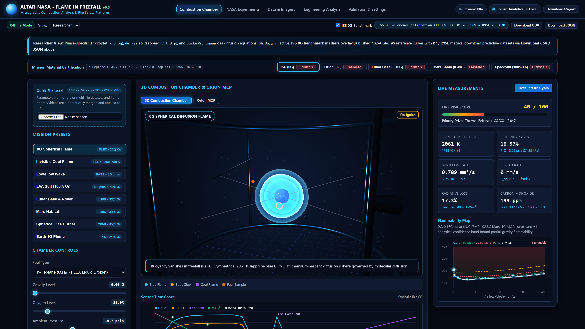

### 2. 0G Spherical Blue Flame, 1G Buoyant Earth Flame, and Cool Flame Sonification

Switching presets on the left panel — or dragging the gravity slider from `0.00 G` up to `1.00 G` — immediately updates both the transport numbers and the 3D reaction geometry. At `0G`, oxygen diffuses symmetrically inward to form a sapphire-blue chemiluminescent sphere; at `1G`, buoyant convection (`Ra`) stretches the plume upward and restores bright yellow soot incandescence.

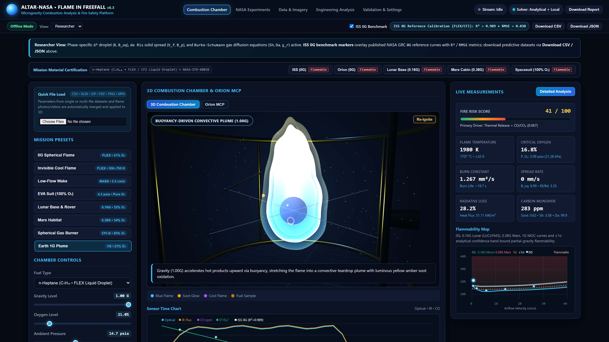

Selecting the **Invisible Cool Flame** scenario transitions the chamber into the post-radiative-extinction `550–750 K` `NTC` regime. Turning on **Telemetry Sonification** (`Audio On`) in the lower-left panel maps flame temperature, radiative heat flux, and sub-visible cool-flame oscillations into audio frequencies with a live oscilloscope trace so operators can hear regime transitions without watching the screen.

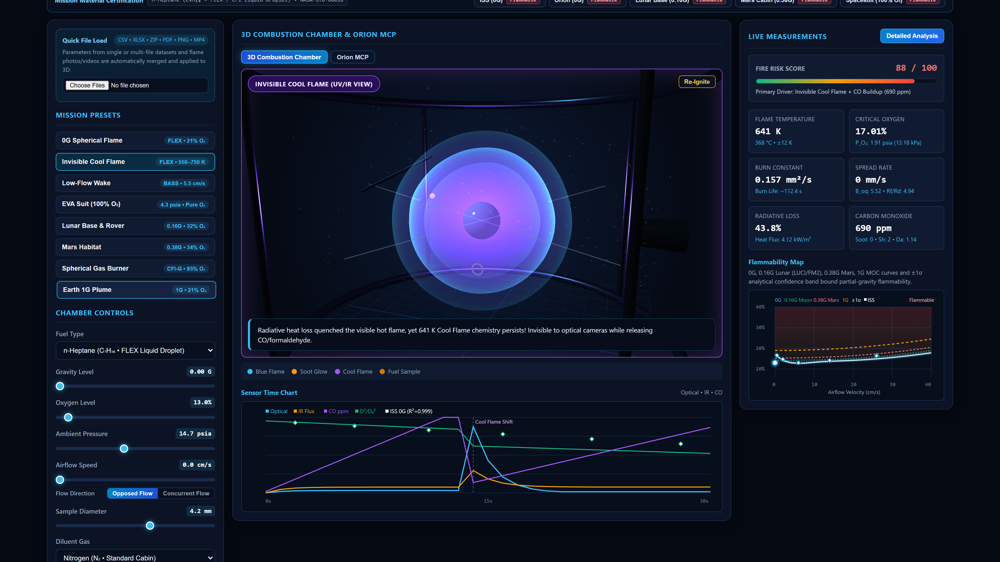

### 3. Custom Material Twin, Flow Direction, Flammability Map, and Life Support Clock

Beyond standard flight fuels (`n-Heptane`, `Methanol`, `Cast PMMA`, `Sibal Cloth`, `Nomex HT90-40`, `Propane`, and `Hydrogen`), choosing **Custom Material** lets you enter your own polymer (`PEEK`, `PTFE`, `XLPE`, `Kapton`, etc.) along with density (`kg/m³`) and thermal conductivity (`W/mK`). The physics core computes thermal inertia (`ρ·c_p·λ`) and pairs the sample with its closest NASA-tested thermophysical analog. Toggling airflow between **Opposed** and **Concurrent** redraws the 21-point **Flammability Boundary Map** on the right, plotting `0G`, `0.16G Moon`, `0.38G Mars`, and `1G Earth` `MOC` curves together with `±1σ` uncertainty bands.

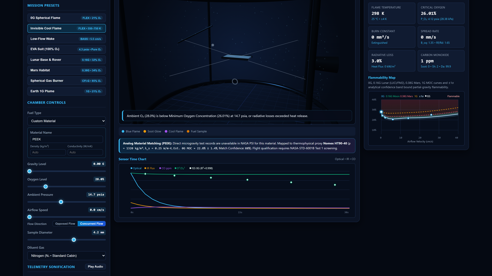

Scrolling down reveals the live **Physical Equations** table (`d²` burn constant `K`, `Spalding B_oq`, `de Ris` spread rate `V_f`, `Sherwood Sh`, `Damköhler Da`, and radiative fraction `χ_r`) alongside the **Life Support Clock**, which integrates carbon monoxide accumulation against `NASA JSC-20584 SMAC` limits across `ISS Destiny (70 m³)`, `Orion / Gateway (19 m³)`, `Pressurized Lunar Rover (11 m³)`, `Mars Surface Cabin (28 m³)`, and an `EVA Spacesuit (0.18 m³)`.

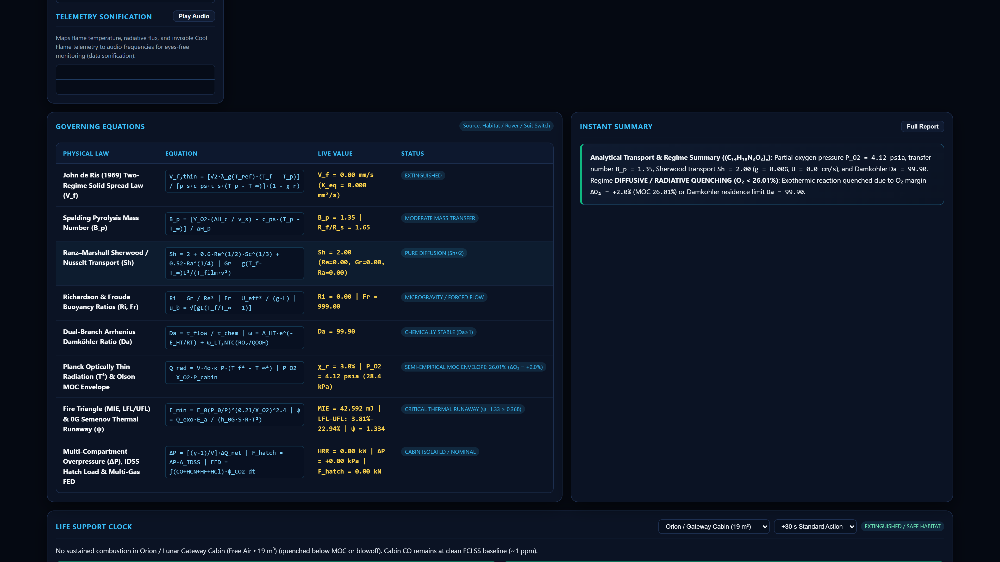

### 4. Orion MCP 3D Spacecraft: Exterior Hull and 5-Compartment Cutaway

Clicking **Orion MCP** above the central viewport switches from the test rack to a 3D spacecraft digital twin modeled around the Artemis Orion Crew Module and Airbus European Service Module (`ESM`). In **Exterior Hull** mode, you can inspect the heat-shielded crew module, radiator panels, and quad solar wings in orbit.

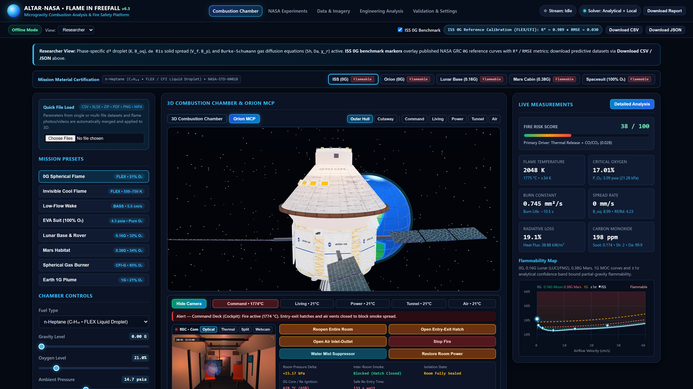

Switching to **Cutaway** opens the hull to expose five interconnected pressurized bays — **Command**, **Living**, **Power & Avionics**, **Docking Tunnel**, and **Airlock** — linked by inter-module ventilation (`IMV`) ducts and hatches, with quick-focus buttons along the top bar.

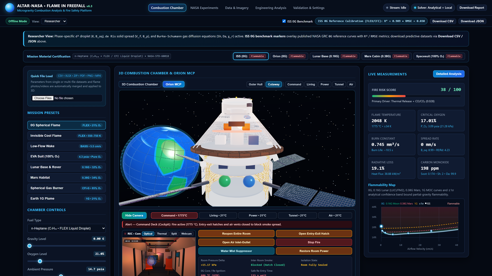

### 5. Live 3D Room Cameras, 5-Step Sequential Auto Response, and Cabin Air Scrubbing

Below the spacecraft viewport, each bay has a dedicated 3D interior perspective camera with four operating modes: **Optical**, long-wave infrared **Thermal (`LWIR Ironbow`)**, side-by-side **Split** (`OPTICAL | LWIR IR` with radiometric colorbar and `T_max` hotspot reticle), and live **Webcam** optical flame-flicker detection. Triggering **Start Fire Test** raises compartment temperature and risk; once the **Auto-Protection** threshold (`Risk ≥ 65`) is crossed, an autonomous countdown bar appears with a **Manual Override** button for crew intervention.

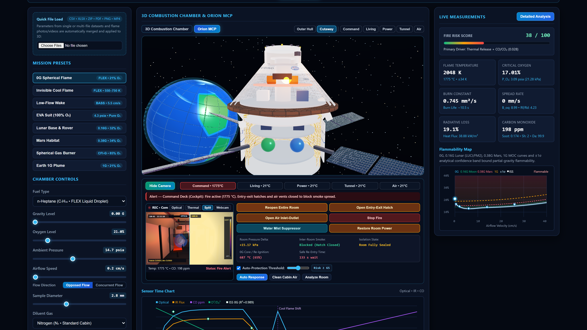

When the countdown finishes — or whenever you press **Auto Response** — the spacecraft executes a 5-step sequential fire suppression protocol (`1/5 -> 5/5`):
1. **Sensor Confirmation (`1/5`):** Cross-checks optical, `LWIR` thermal (`T_max`), and `CO` channels to rule out dust false alarms.
2. **Ventilation Cutoff (`2/5`):** Shuts `IMV` duct fans to starve forced oxygen supply and stop smoke transport into adjacent bays.
3. **Power Isolation & Hatch Seal (`3/5`):** Trips `120 VDC SSPC` power feeds and seals the bay entry hatch.
4. **Fine Water Mist Suppression (`4/5`):** Discharges `<40 µm` `SoFIE-MIST` water mist. Under `NASA-STD-6001B`, `Halon 1301` is strictly prohibited inside crewed spacecraft because flame pyrolysis converts it into toxic, corrosive `HF` and `HBr` acid gases that poison closed-loop life support scrubbers.
5. **Atmospheric Stabilization & Thermal Cooling (`5/5`):** Tracks hot-core cooling in `0G` until surface temperature drops below the `525 K` flash-reignition threshold.

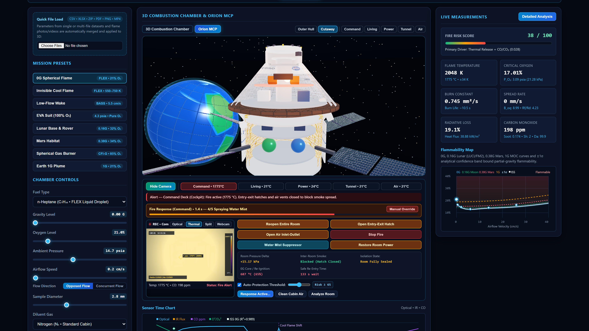

After knockdown, **Clean Cabin Air** (`CAMRAS` post-fire scrubbing) removes residual `CO` and combustion aerosols while the telemetry readout tracks bay pressure differential (`ΔP`), inter-room smoke leakage (`g/s`), reignition risk, and safe hatch re-entry time.

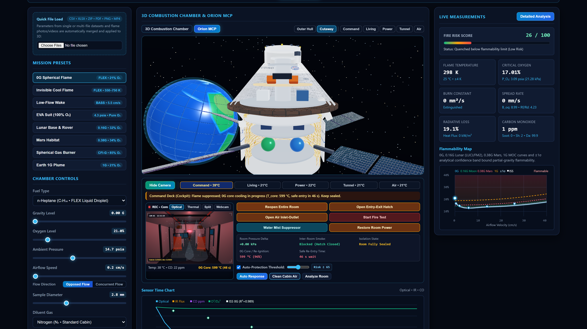

### 6. Tab 2 — NASA PSI Experiment Ranking, Variations, Comparison, and Earth Applications

The **NASA Experiments** tab ranks `15+` verified NASA `PSI` flight investigations (`FLEX`, `FLEX-2`, `BASS`, `BASS-II`, `Saffire I–VI`, `SoFIE`, `ACME CFI-G`, `E-FIELD`, `SPICE`, `SLICE`, `SAME`, `DAFT`) by physical similarity to your active 3D chamber state, with hardware filters for `ISS CIR / ACME`, `MSG Flow Tunnel`, `Cygnus Spacecraft`, and `Cabin Smoke & Dust`.

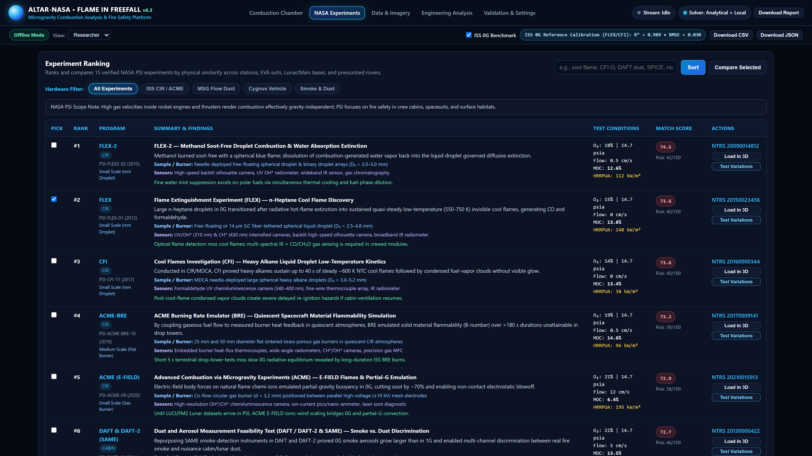

Clicking **Test Variations** on any row reveals individual run matrices that load directly into the 3D chamber. Below, **Experiment Comparison** places multiple missions side by side with `0G–1G` bounding notes, while **Earth Applications** documents how orbital fire research transfers into firefighter turnout fabrics, lightweight `SCBA` breathing cylinders, multi-wavelength smoke detectors, and cleaner terrestrial engines.

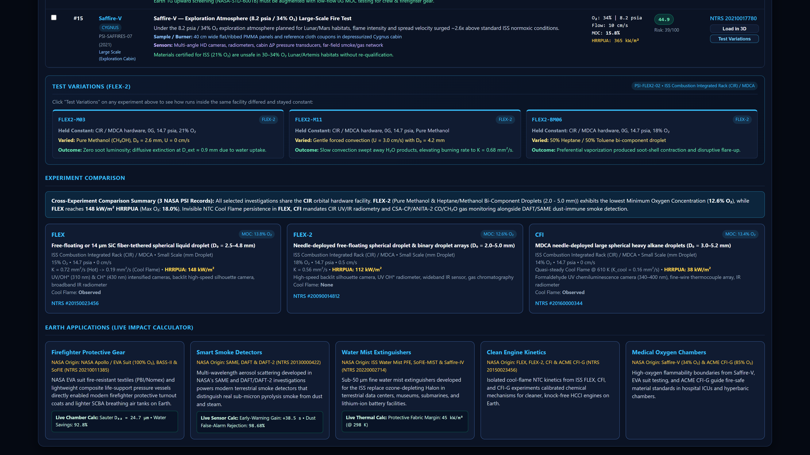

### 7. Tab 3 — Live NASA Stream, Computer Vision (CV), and AST Equation Verifier

The **Data & Imagery** tab connects external experimental datasets directly to the 3D simulator. Through **Live NASA Stream** and **NASA Archive Query**, you can poll official `psi.nasa.gov`, `ntrs.nasa.gov`, and `osdr.nasa.gov` endpoints in real time, or paste a NASA investigation URL into **Resolve Web URL** to pull test parameters straight into the 3D chamber.

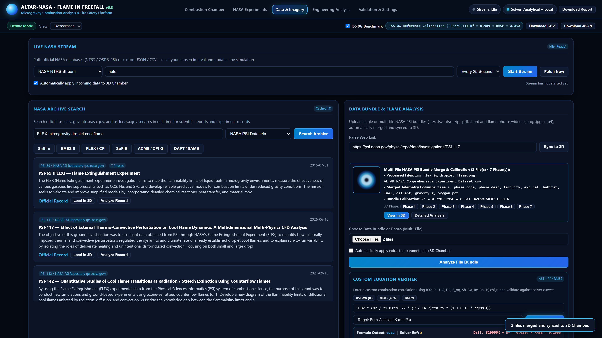

On the right column, dropping single files or multi-file bundles (`.csv`, `.tsv`, `.xlsx`, `.zip`, `.json`, `.pdf` paired with `.png`, `.jpg`, `.gif`, or `.mp4` flame imagery) runs computer-vision flame segmentation — extracting sphericity, blue chemiluminescence vs. yellow soot luminosity, and `Rf/Rd` standoff ratio — alongside automatic tabular calibration. Beneath it, the **Custom Equation Verifier** evaluates user-written correlations (`O2, P, U, G, D0, B_oq, Sh, Da, Re, Ra, Tf, chi_r`) through a whitelist `AST` parser (never `eval()`) and reports `R²` and `RMSE` against the analytical solver curve.

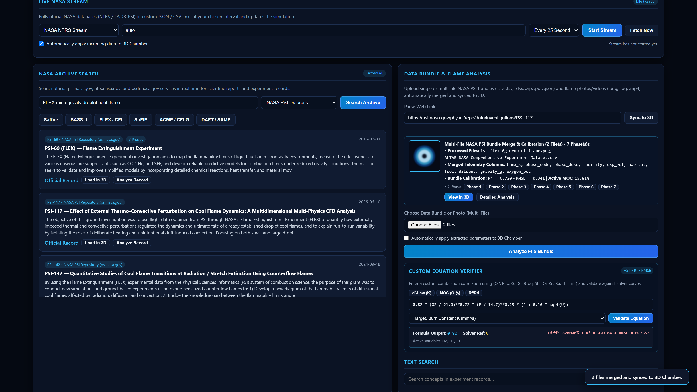

### 8. Tab 4 — Engineering Analysis, Misconception Checks, and One-Click Actions

The **Engineering Analysis** tab provides equation-backed decision support across four selectable modes: the built-in deterministic **Analytical Physics Solver** (requiring zero internet or external keys), **Offline Local Model (`Ollama`)**, **Local System Bridge**, and optional cloud gateways.

A domain-specific scope and physics verifier keeps answers strictly focused on spacecraft fire safety and combustion science, politely declining unrelated or polysemous everyday queries while catching common physical misconceptions — such as placing smoke detectors on a `0G` "ceiling", expecting fire to burn in hard vacuum without an oxidizer, pouring bulk liquid water in `0G`, or reopening a sealed bay hatch before the hot core cools — and prepending a clear **Physics Note** badge and explanation. Interactive **Load in 3D** and **Start Fire Response** buttons beneath each engineering report apply the analyzed scenario directly to the 3D workspace, while **Download Report** in the top bar exports a self-contained `.HTML / PDF` engineering report complete with vector `SVG` plots and tables.

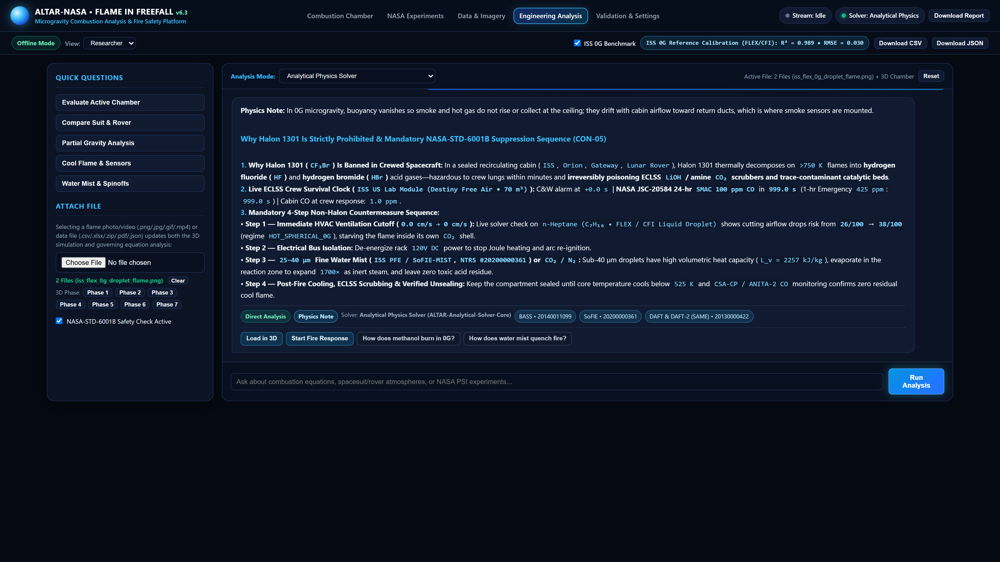

### 9. Tab 5 — Enforced Physical Rules and 100% Offline Local Model Architecture

The **Validation & Settings** tab lists every mandatory transport law and `NASA-STD-6001B` safety constraint audited across the platform, lets you benchmark active solver latency, manages local offline `Ollama` (`http://127.0.0.1:11434`) models, and stores any optional external gateway credentials strictly inside your local user profile (`%APPDATA%\AltarNasa_EN\config.json`), never inside the repository.

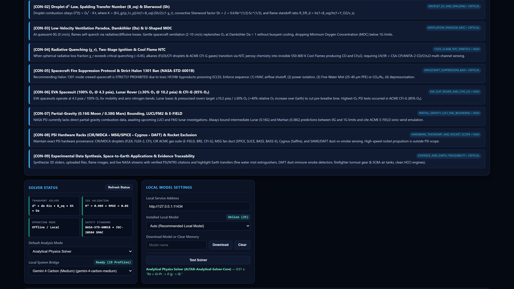

---

## Governing Physical Models & Safety Standards

| Physical Model / Standard | Mathematical Relation & Role | Spacecraft Fire-Safety Meaning |
| :--- | :--- | :--- |
| **Godsave–Spalding `d²`-Law** | $d^2(t) = d_0^2 - K \cdot t$, $K = \frac{8 \rho_g D_{im}}{\rho_l} \ln(1 + B_{oq})$ | Governs spherical droplet regression rate `K` and total burn lifetime in `0G` (`ISS FLEX`). |
| **Spalding Transfer Number (`B_oq`)** | $B_{oq} = \frac{Y_{O_2,\infty} \Delta H_c / \nu_s - c_p (T_s - T_\infty)}{L_v}$ | Measures enthalpy driving force relative to latent heat of vaporization and sets flame standoff `Rf/Rd`. |
| **de Ris Solid Flame Spread (`V_f`)** | Thermally thin/thick opposed & concurrent surface energy balance | Predicts spread velocity across `PMMA`, `Sibal`, `Nomex`, and custom polymers (`PEEK`, `PTFE`) under low fan flow (`BASS`, `Saffire`). |
| **Burke–Schumann Gas Diffusion** | Stoichiometric flame sheet radius under metered burner flow | Models steady spherical gas-burner flames (`ACME CFI-G`, `SLICE`) where burner diameter stays fixed. |
| **Dimensionless Transport (`Gr, Ra, Ri, Sh`)** | $Sh = 2 + 0.6 Re^{1/2} Sc^{1/3}$, $Ra = Gr \cdot Pr$ | Captures the transition from pure diffusion (`0G`) through Lunar (`0.16G`) and Martian (`0.38G`) partial buoyancy to `1G`. |
| **Damköhler (`Da`) & Radiative Loss (`χ_r`)** | Chemical-to-flow timescale ratio and radiative heat-loss fraction | Identifies low-stretch radiative quenching and transition into `550–750 K` invisible cool flames. |
| **`NASA-STD-6001B` & `JSC-20584 SMAC`** | Upward flammability (`Test 1`), `MOC` thresholds, and `CO` exposure limits | Enforces 5-phase mission material certification, `Halon 1301` prohibition, and crew `CO` survival margins. |

---

## Project Directory Structure & Zero-Trust Architecture

```text
Nasa-English/
├── main_nasa.py                  # Local 127.0.0.1 Flask server, API routes, and --self-test suite
├── build_serverless_web.py       # Static compiler generating the zero-backend web_serverless/ bundle
├── nasa_icon.py                  # Multi-resolution desktop application icon generator
├── Nasa_4.spec                   # Single-file standalone Windows .exe (PyInstaller) specification
├── Nasa_Run_Now.bat              # Zero-install one-click launcher for Windows machines without Python/Git
├── Nasa_Build_EXE.bat            # One-click standalone Nasa_4.exe builder from source
├── requirements.txt              # Verified Python dependencies (Flask, numpy, PyMuPDF, Pillow, certifi)
├── LICENSE                       # Official unmodified Apache License 2.0 text
├── NOTICE                        # Copyright and open-science attribution notices
├── core/
│   ├── physics_engine.py         # d², de Ris, Burke-Schumann, MOC (±1σ), 5-phase certification & AST solver
│   ├── ignition_kinetics.py      # Ignition delay, NTC cool-flame kinetics, and hot-core reignition model
│   ├── compartment_network.py    # 5-bay Orion MCP pressure, hatch force, and smoke transport network
│   ├── fdir_hardware_bus.py      # IMV fan, 120 VDC SSPC, hatch seal, water mist, and CAMRAS state bus
│   ├── data_vision_processor.py  # Multi-file CSV/XLSX/ZIP/PDF parser and CV flame segmentation engine
│   ├── nasa_datasets.py          # Verified 15+ NASA PSI investigation catalog and material properties
│   ├── nasa_live_fetcher.py      # Official psi.nasa.gov / ntrs.nasa.gov / osdr.nasa.gov live client
│   ├── ranking_engine.py         # Physics-weighted PSI ranking and multi-investigation comparison engine
│   ├── scope_guard.py            # Domain scope guard, polysemy lock, and misconception detector
│   ├── smart_synthesizer.py      # Offline equation-driven engineering report synthesizer
│   ├── ai_engine.py              # Hybrid analytical solver, local Ollama, and optional gateway router
│   ├── directives.py             # Mandatory transport laws and NASA-STD-6001B safety constraints
│   ├── config_manager.py         # Thread-safe local user config (%APPDATA%\AltarNasa_EN or .runtime/userdata_en)
│   └── security_guard.py         # 127.0.0.1 loopback enforcement, CSRF token check, and SSRF allowlist
├── web/
│   ├── templates/index.html      # Mission Control UI template (pure English aerospace interface)
│   └── static/                   # CSS, Three.js, 3D chamber, 3D Orion MCP, charts/sonifier, and controller JS
├── web_serverless/               # 100% serverless static browser edition deployed to GitHub Pages
├── sample_data/                  # Comprehensive 7-phase NASA PSI experiment dataset (.csv)
├── scripts/
│   ├── bootstrap_nasa.ps1        # Zero-registry portable Python 3.12.8 + optional portable Ollama bootstrapper
│   └── Modelfile.nasa-portable   # Local offline science model system profile
└── docs/screenshots/             # Authentic 1920x1080 (@2x) English UI & WebGL screenshots
```

**Security & Isolation Design:**
- **Loopback-Only Binding (`127.0.0.1`):** The local Python/desktop server never binds to `0.0.0.0`, enforces per-session `CSRF` tokens on every `POST` route, and restricts remote URL fetches to verified `*.nasa.gov` science domains.
- **Safe `AST` Formula Sandbox:** Custom user equations are parsed through a strict mathematical Abstract Syntax Tree (`AST`) whitelist without ever invoking `eval()`.
- **Zero-Backend Browser Bundle (`web_serverless/`):** The GitHub Pages deployment runs under a strict `Content-Security-Policy (CSP)` with zero server-side code; uploaded images and tables stay inside browser memory.

---

## How to Run (4 Options — Including Zero-Install Paths for Users Without Python or Git)

You do not need Python, Git, or any development tools pre-installed to explore the platform:

### Option 1 — Open Directly in Your Browser (Zero Download, All Devices)

Click the live GitHub Pages deployment from any desktop, laptop, or tablet browser:

- **Live Web App:** https://faruk042.github.io/Nasa-English/

You can also double-click `web_serverless/index.html` inside any downloaded copy of this repository to run the exact same serverless 3D edition offline.

### Option 2 — Download Standalone Windows `Nasa_4.exe` (Fastest One-Click Desktop App)

If you want the full desktop edition (including local `127.0.0.1` server, live NASA PSI/NTRS bridge, and local Ollama integration) with zero setup:

1. Open **[GitHub Releases (`v6.3`)](https://github.com/Faruk042/Nasa-English/releases/latest)** and download **`Nasa_4.exe`**.
2. Double-click `Nasa_4.exe` to launch immediately.
   *(Note: Because `Nasa_4.exe` is an unsigned open-source PyInstaller binary, if Windows SmartScreen displays an informational prompt on first launch, click **More info -> Run anyway**.)*

### Option 3 — `Download ZIP` + Zero-Install Auto-Setup Launcher (`Nasa_Run_Now.bat` — Even Without Python Installed)

If you download the source ZIP on a fresh Windows PC without Python or Git:

1. Click **`Code -> Download ZIP`** at the top right of this page and extract the folder anywhere on your computer.
2. Double-click **`Nasa_Run_Now.bat`**.
   - Without touching the Windows Registry or your global system `PATH`, `scripts/bootstrap_nasa.ps1` automatically provisions official portable **Python 3.12.8**, an isolated `.runtime/venv` virtual environment, required scientific wheels, and optional portable local `Ollama` strictly inside the project's local `.runtime/` folder, then opens the application.
   - If the machine has no internet access at all, it automatically falls back to launching `web_serverless/index.html` offline.
   - Anyone wishing to compile their own standalone `Nasa_4.exe` from source can simply double-click **`Nasa_Build_EXE.bat`**.

### Option 4 — Manual Python / Git Setup for Developers (Windows / macOS / Linux)

```bash
git clone https://github.com/Faruk042/Nasa-English.git
cd Nasa-English

# Create and activate a virtual environment
python -m venv .venv
# Windows:
.venv\Scripts\activate
# macOS / Linux:
# source .venv/bin/activate

pip install -r requirements.txt

# Run the automated verification suite (exits with code 0)
python main_nasa.py --self-test

# Launch the local Mission Control server on 127.0.0.1
python main_nasa.py
```

For optional 100% offline local LLM synthesis, install [Ollama](https://ollama.com) and run `ollama pull qwen3.5:4b`; the platform detects the local service automatically.

---

## License

This project is open-source software licensed under the **[Apache License 2.0](LICENSE)**. See **[NOTICE](NOTICE)** for attribution details and open-science data credits.
